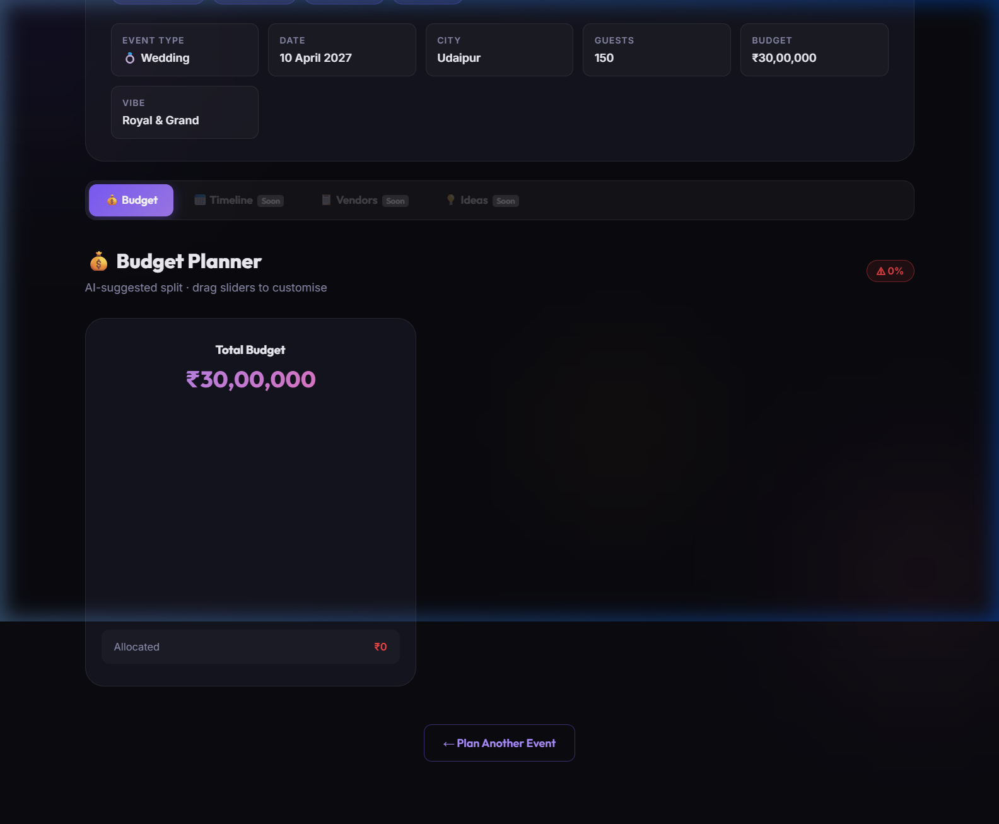
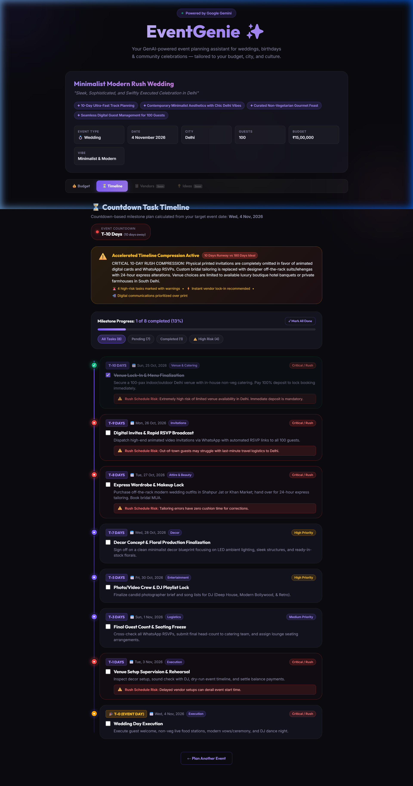
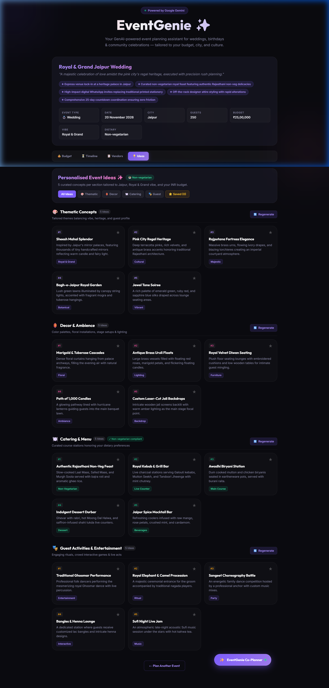
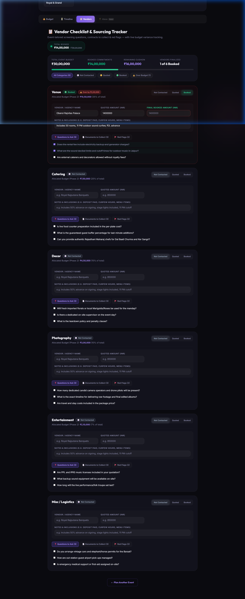

# EventGenie ✨
> **GenAI-Powered Event Planning Co-Pilot for Weddings, Birthdays, and Community Celebrations**

EventGenie is an intelligent, full-lifecycle event planning assistant built with **React 19**, **Node.js/Express**, and the **Google Gemini API**. It converts high-level event concepts into complete, financially balanced, culturally authentic, and publication-ready blueprints in seconds.

---

## 📸 Screenshots

| 💰 Interactive Budget Planner | ⏳ Rush-Compressed Timeline |
| :---: | :---: |
|  |  |

| 💡 Personalized Ideas & Favorites | 📋 Vendor Screening Checklist |
| :---: | :---: |
|  |  |

---

## 🌟 Key Features

### 1. 📝 Intelligent Event Intake & AI Engine
- **Culturally Attuned**: Deep understanding of Indian weddings (Marwari, South Indian, Punjabi, etc.), modern urban birthday parties, and eco-friendly community fundraisers.
- **Strict Schema Enforcement**: Powered by `@google/generative-ai` with structured JSON schema outputs.
- **Resilient Fallback Loop**: Automatic failover across `gemini-3.5-flash`, `gemini-3.6-flash`, `gemini-3.5-flash-lite`, and `gemini-flash-latest` with exponential backoff.

### 2. 💰 Interactive Budget Planner (Phase 2)
- **Recharts Donut Visualization**: Dynamic multi-color category split.
- **Lockable Categories**: Lock essential allocations while other categories auto-balance proportionally.
- **Real-Time Sliders**: Adjust rupee allocations and category percentages with continuous sum-to-100% enforcement.

### 3. ⏳ Countdown Timeline Generator (Phase 3)
- **Countdown-Based Action Plan**: Chronological milestones (T-180 days, T-90, T-30, T-0).
- **Dynamic Rush Compression**: Automatically compresses milestones when the planning window is shorter than the ideal lead time (e.g. wedding in 10 days vs 6 months).
- **Risk Indicators**: Highlights critical rush tasks (venue contract, catering lock-in, invites) with urgency badges and warning guidance.
- **Persistent Task Checklists**: Check off completed tasks with state saved in `localStorage`.

### 4. 📋 Vendor Screening Checklist (Phase 4)
- **Tailored Questionnaires**: Category-specific probing questions (e.g. pure vegetarian Maharaj credentials for weddings; kid portions & allergy handling for birthdays; municipal sound licenses for fundraisers).
- **Red Flags Watchlist**: Flags predatory clauses, vague overtime surcharges, and missing insurance.
- **Live Budget Variance Tracker**: Track vendor statuses (`Not contacted` / `Quoted` / `Booked`) and quotes against allocated budgets with instant over-budget warnings.
- **Ethical AI**: **Never** fabricates fake vendor names, phone numbers, or arbitrary prices.

### 5. 💡 Personalized Ideas & Conversational AI Co-Planner (Phase 5)
- **4 Curated Categories**: 5 rich ideas each for *Thematic Concepts*, *Decor & Ambience*, *Catering & Menu*, and *Guest Activities*.
- **Strict Dietary Compliance**: Menus strictly adhere to dietary restrictions (Pure Vegetarian, Jain, Vegan, Halal).
- **Independent Regeneration**: Dedicated `🔄 Regenerate` buttons refresh single categories on demand.
- **Persistent Favorites**: Star favorite ideas across sections and filter via `⭐ Saved`.
- **Live AI Co-Planner Chat**:
  - Full active plan awareness (budget split, countdown dates, vendor quotes, ideas).
  - Executes real state changes (e.g., *"cut the budget by 20%"*, *"make it vegetarian"*, *"move the event 2 weeks earlier"*).
  - Displays before/after diff summary cards with instant **↩ Undo** support.

### 6. 📄 Clean PDF Export & Offline Demo Mode (Phase 6)
- **Multi-Page Publication PDF**: Exports a clean, vector-rendered A4 document containing the event summary, budget table, timeline countdown, vendor screening statuses, and saved ideas with zero text cut-offs.
- **⚡ Offline Demo Mode**: Pre-loaded with 3 complete, rich sample blueprints (Jaipur Wedding, Cyberpunk Birthday, Green Charity Gala) requiring **zero API calls** and working completely offline.
- **Polished UX**: Consistent floating toast notifications, dark glassmorphic styling, and full 375px mobile responsiveness.

---

## 🛠️ Tech Stack

- **Frontend**: React 19, Vite, Tailwind CSS v4, Recharts v3, jsPDF, Axios
- **Backend**: Node.js (ESM), Express 4, Google Generative AI SDK (`@google/generative-ai`)
- **AI Models**: Google Gemini (`gemini-3.5-flash`, `gemini-3.6-flash`, `gemini-3.5-flash-lite`, `gemini-flash-latest`)
- **Styling**: Modern Glassmorphism Design System, CSS Variables, Outfit & Inter Typography

---

## 📁 Repository Structure

```
EventGenie/
├── backend/
│   ├── prompts/
│   │   └── intake.js          # System prompts & schema guidelines
│   ├── routes/
│   │   └── plan.js            # Plan generation, section regeneration & AI chat routes
│   ├── .env.example           # Environment variable template
│   ├── package.json
│   └── server.js              # Express API server (:4000)
├── frontend/
│   ├── src/
│   │   ├── api/
│   │   │   └── client.js      # Axios client with proxy configuration
│   │   ├── components/
│   │   │   ├── BudgetPlanner.jsx       # Interactive pie chart & sliders
│   │   │   ├── TimelineGenerator.jsx   # Countdown milestones & rush warnings
│   │   │   ├── VendorChecklist.jsx     # Vendor screening & budget variance
│   │   │   ├── PersonalizedIdeas.jsx   # 4 categories, regeneration & favorites
│   │   │   ├── ChatAssistant.jsx       # Conversational AI Co-Planner with Undo
│   │   │   ├── IntakeForm.jsx          # Event intake form with instant demo chips
│   │   │   ├── LoadingState.jsx        # Step-by-step progress animation
│   │   │   └── Toast.jsx               # Floating feedback notifications
│   │   ├── data/
│   │   │   └── samplePlans.js          # Offline demo blueprints (Wedding, Birthday, Gala)
│   │   ├── utils/
│   │   │   └── exportPdf.js            # Multi-page vector PDF generation engine
│   │   ├── pages/
│   │   │   └── Home.jsx                # Main orchestration & navbar
│   │   ├── App.jsx                     # Background ambient lighting shell
│   │   └── index.css                   # Glassmorphic tokens & animations
│   ├── package.json
│   └── vite.config.js                  # Vite dev server with proxy to backend (:4000)
├── docs/
│   └── screenshots/                    # Feature preview screenshots
└── README.md
```

---

## ⚡ Quick Start Guide

### 1. Prerequisites
- **Node.js** v18 or higher
- **npm** v9 or higher
- A **Google Gemini API Key** from [Google AI Studio](https://aistudio.google.com/)

---

### 2. Backend Setup

1. Open a terminal and navigate to `backend/`:
   ```bash
   cd backend
   npm install
   ```

2. Configure environment variables:
   ```bash
   cp .env.example .env
   ```
   Open `backend/.env` and paste your Gemini API key:
   ```env
   GEMINI_API_KEY=AIzaSy...your_actual_key_here
   PORT=4000
   ```

3. Launch the backend server:
   ```bash
   npm run dev
   ```
   *The backend will start at `http://localhost:4000`.*

---

### 3. Frontend Setup

1. In a second terminal, navigate to `frontend/`:
   ```bash
   cd frontend
   npm install
   ```

2. Start the Vite development server:
   ```bash
   npm run dev
   ```
   *Open `http://localhost:5173` in your browser.*

---

### 4. ⚡ Offline Demo Mode (Zero Setup Required)

If you don't have an API key or wish to demonstrate the platform instantly without internet:
1. Open `http://localhost:5173`.
2. Click any of the quick sample chips on the landing page:
   - **💍 Jaipur Wedding (₹25L)**
   - **🎂 21st Birthday (₹3.5L)**
   - **🌍 Charity Gala (₹12L)**
   Or use the **"⚡ Load Sample Plan"** dropdown in the top navigation bar.
3. The full interactive blueprint will load **instantly with zero API calls**, enabling testing of all 4 tabs, PDF exports, and budget calculations.

---

## 📄 PDF Export Verification

The PDF export engine produces multi-page vector documents with proper page breaks and running headers/footers:

| Event Blueprint | Page Count | Generated File Size | Key Sections Verified |
| :--- | :---: | :---: | :--- |
| **Rajputana Royal Palace Wedding** | 3 Pages | ~48 KB | Summary, Proportional Budget Bar, T-180d Countdown, Marwari Maharaj Checklist, 20 Ideas |
| **Cyberpunk 21st Birthday** | 3 Pages | ~43 KB | Summary, Rooftop Lounge Allocation, T-45d Countdown, DJ Rider Checklist, Neon Decor & Sliders |
| **Green Future Charity Gala** | 3 Pages | ~43 KB | Summary, Zero-Waste Allocation, BMC Permits & Police NOCs, Living Stage & Recovery Bowls |

---

## 🔒 Security & Git Hygiene

- `backend/.env` is strictly listed in `.gitignore` and has **never** been committed to git.
- Zero API keys, secrets, or confidential credentials exist in the codebase.
- Client requests are proxied internally through Vite to keep backend ports decoupled.

---

## ⚠️ Known Limitations & Honest Disclosures

1. **Gemini Free-Tier Rate Limits**:
   Google AI Studio free-tier keys enforce a 15 requests/minute (RPM) quota. EventGenie implements an automatic 4-model fallback sequence (`gemini-3.5-flash` → `gemini-3.6-flash` → `gemini-3.5-flash-lite` → `gemini-flash-latest`) to mitigate rate limits, alongside the built-in Offline Demo Mode.
2. **Client-Side Persistence**:
   Task completion checkboxes, vendor quoted amounts, and favorited ideas are persisted in `localStorage` scoped to the current browser. Clearing browser data will reset custom edits.
3. **Calendar Conventions**:
   Event countdown dates are calculated using the Gregorian standard calendar with leap-year adjustments.

---

## 🏆 Completed Development Roadmap

- [x] **Phase 1**: Intake form + GenAI event blueprint generation
- [x] **Phase 2**: Interactive Budget Planner with Recharts pie chart, lockable categories & editable sliders
- [x] **Phase 3**: Countdown Timeline view with calendar integration & rush compression engine
- [x] **Phase 4**: Vendor management checklist with questions, red flags & live budget variance tracking
- [x] **Phase 5**: Personalized ideas hub (5 per section, regeneration, favorites) & AI Co-Planner Chat with live plan mutations and Undo
- [x] **Phase 6**: Clean vector PDF export, offline demo mode, UI polish, and comprehensive documentation
